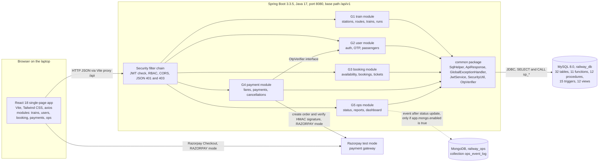
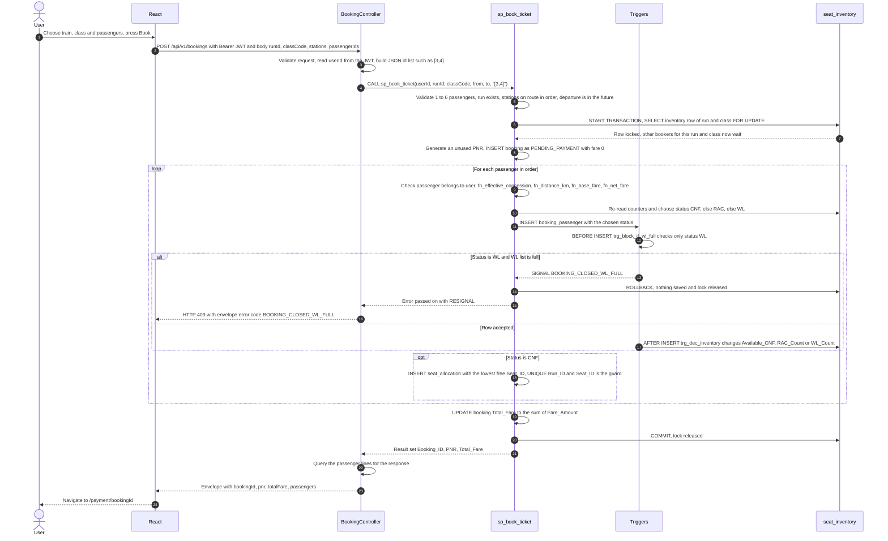
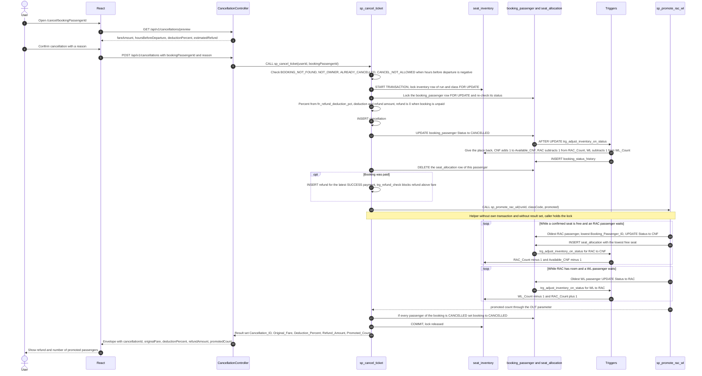
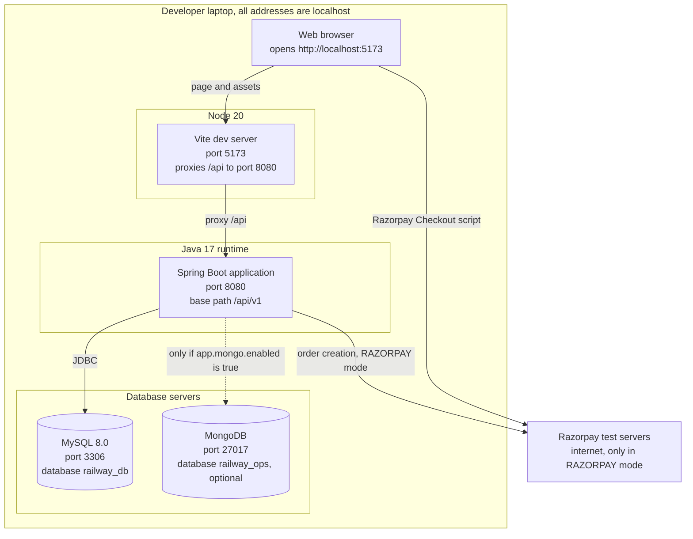

# System Architecture

**National Railway Reservation & Management System** — DBMS project, PICT (E&TCE)

| Item | Value |
|---|---|
| File | `docs/ARCHITECTURE.md` (task I2) |
| Version / date | 1.0 / 2026-10-28 |
| Derived from | Master Prompt Part 2 contract (C1–C11) and rules R1–R18 |
| Companion document | `docs/INTEGRATION_MAPPING.md` (ownership, foreign keys, cross-group dependencies) |

## Contents

1. [Overview](#1-overview)
2. [System architecture](#2-system-architecture)
3. [Booking sequence](#3-booking-sequence)
4. [Cancellation sequence with RAC promotion](#4-cancellation-sequence-with-rac-promotion)
5. [Deployment on a laptop](#5-deployment-on-a-laptop)
6. [Security model](#6-security-model)
7. [Concurrency control](#7-concurrency-control)
8. [MySQL versus MongoDB](#8-mysql-versus-mongodb)
9. [Technology justification](#9-technology-justification)

---

## 1. Overview

The system is a three-tier web application:

- **Presentation tier**: a React 18 single-page application (Vite, Tailwind CSS, react-router-dom, axios, recharts), served on port 5173.
- **Application tier**: one Spring Boot 3.3.5 application (Java 17, Maven) on port 8080 with five feature modules and a shared `common` package. It is **SQL-first**: controllers call services, services call `SqlHelper` (a thin wrapper around `JdbcTemplate`), and `SqlHelper` runs SQL or `CALL sp_*`. There are no JPA entities and no Lombok.
- **Data tier**: MySQL 8.0 (InnoDB) holds all business data and **all business rules that must be atomic** (stored procedures, triggers, user-defined functions, views, constraints). MongoDB holds an optional, non-critical operations event log.

The five modules are the same in every layer:

| Group | Module | Backend package | Frontend folder | Main responsibility |
|---|---|---|---|---|
| G1 | Train, Station & Route | `com.railway.train` | `modules/trains` | stations, routes, timetables, trains, coaches, seats, daily runs |
| G2 | Passenger & User | `com.railway.user` | `modules/users` | registration, login, JWT, OTP, roles, passengers |
| G3 | Reservation & Seat | `com.railway.booking` | `modules/booking` | availability, booking with PNR, RAC/WL, seat allocation, tickets |
| G4 | Payment, Cancellation & Refund | `com.railway.payment` | `modules/payments` | fare quote, Razorpay/mock payment, cancellation, refund, fare rules |
| G5 | Railway Operations & Analytics | `com.railway.ops` | `modules/ops` | live train status, delays, revenue and route reports, dashboard |

The database objects behind them: 32 tables, 11 functions, 12 stored procedures, 15 triggers and 12 views.

---

## 2. System architecture

How a request travels:

1. The React page calls `@/api/client` (axios). The client adds `Authorization: Bearer <railway_token>` and calls paths under `/api/v1`; in development the Vite dev server proxies `/api` to port 8080.
2. The security filter chain checks the JWT and the role rules; `@PreAuthorize` in a controller adds the OPERATOR rule.
3. The controller validates the request record (`jakarta.validation`) and calls its service.
4. The service uses `SqlHelper`: a plain `SELECT` against a view or table, or `CALL sp_*` for a business operation.
5. MySQL enforces constraints, runs triggers and returns rows. A business error is raised with `SIGNAL SQLSTATE '45000'` and message `CODE: text`.
6. `GlobalExceptionHandler` converts any exception to the JSON envelope `{"success":false,"error":{"code","message"}}`; success is `{"success":true,"data":<payload>}`.

Component summary:

| Component | Role |
|---|---|
| `SecurityConfig` | stateless security, CORS for `http://localhost:5173`, public GET prefixes, `/api/v1/admin/**` for ADMIN, BCrypt `PasswordEncoder` bean |
| `JwtService` | HS256 token with claims `sub` (user id), `email`, `roles` |
| `SqlHelper` | `query`, `queryOne`, `call`, `update`, `insert`, `scalar`; result keys in lowerCamelCase |
| `GlobalExceptionHandler` | maps SQL, validation, security and constraint errors to the 26 error codes of the contract |
| `OtpVerifier` | interface in `common.otp`; implemented by G2 (`OtpVerifierImpl`) and used by G4 for the payment OTP |

---

## 3. Booking sequence

The sequence of `POST /api/v1/bookings`. The service method that calls `sp_book_ticket` is **not** `@Transactional`; the procedure owns the transaction.

Points to remember for the viva:

- `sp_book_ticket` **never updates `seat_inventory` itself**. It only changes `booking_passenger.Status` through INSERT; the triggers do the arithmetic (rule R9).
- The status of each passenger is decided **after** the inventory row is locked and the counters are re-read, so two users can never be given the same last confirmed seat.
- The first passenger of a booking may be `CNF` and a later one `RAC` or `WL` when the class runs out in the middle of the booking.
- The booking stays `PENDING_PAYMENT` until payment succeeds (G4) or until `sp_expire_unpaid_bookings` marks it `EXPIRED`.

---

## 4. Cancellation sequence with RAC promotion

`POST /api/v1/cancellations` calls G4's `sp_cancel_ticket`, which calls G3's helper `sp_promote_rac_wl` inside the same transaction (contract exception C11-2). The preview call before it uses only SQL functions and changes nothing.

Points to remember for the viva:

- Refund percentage comes from the table `refund_rule` through `fn_refund_deduction_pct(hours)`: 10 % at 48 hours or more, 25 % from 12 up to 48, 50 % from 4 up to 12, 100 % below 4 hours (seed data C6). Cancelling after departure raises `CANCEL_NOT_ALLOWED`.
- Cancelling a confirmed passenger first frees the place (trigger), then the helper fills it with the oldest RAC passenger, then moves the oldest WL passenger into the freed RAC place. The helper repeats until nothing changes.
- All of this happens in one transaction: if any step fails, the cancellation, refund and promotions are rolled back together.

---

## 5. Deployment on a laptop

Everything runs on one machine; nothing is hosted.

| Part | Port | Notes |
|---|---|---|
| React dev server (Vite 5, Node 20) | 5173 | alias `@` = `frontend/src`; proxy `/api` to `http://localhost:8080` |
| Spring Boot | 8080 | `server.port=8080`; CORS allows `http://localhost:5173` |
| MySQL 8.0 | 3306 | database `railway_db`; user and password from `DB_USER` / `DB_PASSWORD` (defaults `root` / `root`) |
| MongoDB | 27017 | database `railway_ops`; used only when `app.mongo.enabled=true` (default `false`); connection timeout 2 seconds |
| Razorpay | internet | only when `app.payment.mode=RAZORPAY`; keys from `RAZORPAY_KEY_ID` and `RAZORPAY_KEY_SECRET` |

Start-up order on a fresh laptop:

1. Install Java 17, Maven, Node 20 and MySQL 8.0 (MongoDB only if the operations event log is wanted).
2. Build the database with `scripts/init-db.ps1` (Windows) or `scripts/init-db.sh` (Linux/macOS); the script runs the `db/*.sql` files in numeric order (see section g of the integration document).
3. Start the backend (standard Maven run of `backend/`).
4. Start the frontend (standard `npm install` and `npm run dev` in `frontend/`).
5. Open `http://localhost:5173`. Every seeded user has the password `Test@1234`; the admin is `admin@railway.test`.

Configuration lives only in `application.yml` keys (rule R15). The ones that matter for a demo:

| Key | Default | Meaning |
|---|---|---|
| `app.auth.dev-mode` | `true` | responses include `devOtp`, so OTP can be demonstrated without email or SMS |
| `app.auth.require-login-otp` | `false` | login OTP off by default |
| `app.auth.require-payment-otp` | `true` | payment needs an OTP |
| `app.payment.mode` | `MOCK` | `MOCK` or `RAZORPAY` |
| `app.mongo.enabled` | `false` | switch on only after MongoDB is installed |
| `app.jwt.secret` | from `JWT_SECRET` | must be at least 32 characters; replace the default outside a classroom demo |

---

## 6. Security model

### 6.1 Passwords: BCrypt

Passwords are never stored or compared in plain text. The register endpoint (minimum 8 characters) hashes the password with the `BCryptPasswordEncoder` bean from `SecurityConfig`, and the hash (`Password_Hash`, VARCHAR(100)) is passed to `sp_register_user`. Login compares the typed password with the hash using the same encoder. The seeded users share one BCrypt hash of `Test@1234`.

### 6.2 Account lock-out and login audit

Every login attempt calls `sp_record_login_attempt`, which writes a row in `login_audit`. Five failed attempts for an existing user set `Locked_Until` to 15 minutes ahead and reset the counter; a successful login clears both. A locked account is answered with `ACCOUNT_LOCKED` (HTTP 423), a wrong password with `INVALID_CREDENTIALS` (401).

### 6.3 JWT

After a successful login (and OTP when required) `JwtService` issues an HS256 token with claims `sub` (user id), `email` and `roles` (names without the `ROLE_` prefix) that expires after `app.jwt.expiry-minutes` (120). The server is **stateless**: no session is kept. The React `AuthContext` stores the token as `railway_token`; the axios client sends it in every request and, on HTTP 401, clears it and moves to `/login`.

### 6.4 Role-based access control (RBAC)

Roles are `PASSENGER`, `ADMIN` and `OPERATOR` (tables `role`, `user_role`; every role change is logged by triggers in `user_role_audit`). Spring authorities are `ROLE_<name>`.

| Level | Rule | Examples |
|---|---|---|
| PUBLIC | `POST /auth/register`, `/auth/login`, `/auth/verify-otp`; `GET /health`; `GET` under `stations, routes, coach-types, trains, runs, availability, tickets, ops` | train search, availability, ticket lookup by PNR, live board |
| AUTH | any other endpoint needs a valid token | `POST /bookings`, `GET /fares/quote`, `POST /payments/orders`, `POST /cancellations` |
| OPERATOR | `@PreAuthorize("hasAnyRole('OPERATOR','ADMIN')")` | `PUT /ops/status/{runId}` |
| ADMIN | everything under `/api/v1/admin/**` | fare rules, reports, user management |

Authorisation is also enforced on **data ownership** inside SQL: `sp_book_ticket` checks that every passenger belongs to the user (`PASSENGER_NOT_OWNED`), `sp_create_payment` and `sp_cancel_ticket` check the booking owner (`NOT_OWNER`), and `GET /bookings/{id}` is limited to the owner or an ADMIN. The frontend route registry (`roles`, `public`) only hides pages; the backend is the real guard. 401 and 403 are returned as the same JSON envelope as every other error.

### 6.5 OTP two-factor authentication

| Purpose | Trigger | Flow |
|---|---|---|
| `PAYMENT` | `app.auth.require-payment-otp=true` (default) | the payment page calls `POST /auth/payment-otp` and receives `challengeId`, `expiresAt` and (in dev mode) `devOtp`; `POST /payments/orders` must then carry `otpChallengeId` and `otp`; G4 calls `OtpVerifier.verify(userId, "PAYMENT", challengeId, otp)` |
| `LOGIN` | `app.auth.require-login-otp=true` (default is false) | login answers `otpRequired=true` with a `challengeId` instead of a token; `POST /auth/verify-otp` returns the token |

An OTP is valid for 5 minutes and single use (`Expires_At`, `Is_Used`); only a hash of it is stored (`Otp_Hash`). A wrong, expired or used OTP gives `OTP_INVALID` (401). With `app.auth.dev-mode=true` the OTP is returned in the response so the demo works without a mail or SMS service.

### 6.6 Payment integrity

In `RAZORPAY` mode the server checks the gateway signature before it confirms a payment: HMAC-SHA256 of `orderId|paymentId` with the Razorpay key secret must equal the signature sent by the browser. In `MOCK` mode the order id is `MOCK_` plus a UUID and `POST /payments/mock-confirm` is available. The key id and secret come only from environment variables, never from the code. A payment moves `CREATED → SUCCESS/FAILED` once; `sp_confirm_payment` rejects a second confirmation with `PAYMENT_NOT_ALLOWED`.

---

## 7. Concurrency control

The railway problem: many users try to book the last seats of the same train at the same moment. The design relies on the database, not on application code.

### 7.1 ACID for the PNR transaction

| Property | How it is achieved |
|---|---|
| Atomicity | `sp_book_ticket` is one transaction: booking, all passenger rows, all seat allocations and the total fare are committed together or rolled back together (`EXIT HANDLER ... ROLLBACK; RESIGNAL;`) |
| Consistency | constraints in the schema: `CHECK` on the counters (`Available_CNF` between 0 and `Total_Seats`, `RAC_Count` up to `Max_RAC`, `WL_Count` up to `Max_WL`), foreign keys, unique PNR, `UNIQUE(Run_ID, Seat_ID)`; the trigger `trg_block_if_wl_full` closes booking when the waiting list is full |
| Isolation | row-level locks with `SELECT ... FOR UPDATE` on the single inventory row of the run and class (7.2) |
| Durability | InnoDB redo log; a committed booking survives a restart |

### 7.2 Locking order and `FOR UPDATE`

`seat_inventory` has exactly one row for each pair (run, class). Every operation that can change availability first locks that row with `SELECT ... FOR UPDATE`. Other transactions for the same run and class wait at this point, so they are processed one after the other; bookings for other trains or classes are not blocked (row-level, not table-level, locking).

Every procedure is meant to use the same order, which prevents deadlocks (rule R10):

`seat_inventory` → `booking` → `booking_passenger` → `seat_allocation` / `payment`

The table below shows the order exactly as the contract describes each procedure. Two places in the contract text do not follow R10 literally (`sp_cancel_ticket` locks `booking_passenger` before it touches `booking`; `sp_confirm_payment` updates `payment` before `booking`); they are recorded as open points in `docs/INTEGRATION_MAPPING.md`, section h.9.

| Procedure | Locks and writes in this order |
|---|---|
| `sp_book_ticket` | lock inventory row; INSERT booking; INSERT booking_passenger (triggers update the counters); INSERT seat_allocation |
| `sp_cancel_ticket` | lock inventory row; lock booking_passenger; INSERT cancellation; UPDATE status (trigger updates counters); DELETE seat_allocation; INSERT refund; CALL `sp_promote_rac_wl`; UPDATE booking |
| `sp_promote_rac_wl` | locks the inventory row again (the caller already holds it, so there is no wait), then only status UPDATEs and seat_allocation INSERTs |
| `sp_expire_unpaid_bookings` | per booking, its own transaction: inventory lock, cancel passengers, delete allocations, promote, set EXPIRED |

Two details explain why the answer is always correct:

1. Under InnoDB's default isolation level (REPEATABLE READ) a plain `SELECT` may show an older snapshot, but `SELECT ... FOR UPDATE` reads the **latest committed** row. The procedure therefore decides CNF, RAC or WL from counters read **after** the lock.
2. **Counters are changed only by triggers** (rule R9). Because the trigger runs in the same statement and transaction as the status change, counters and passenger rows can never disagree.

Example: two users book the last seat. Both reach the lock; the first gets it, reads `Available_CNF = 1`, inserts a CNF passenger (trigger lowers it to 0) and commits. The second then gets the lock, reads `Available_CNF = 0` and becomes RAC (or WL, or is refused with `BOOKING_CLOSED_WL_FULL`).

### 7.3 Unique seat guard

Even if a coding mistake allowed two transactions to choose the same seat, `seat_allocation` has `UNIQUE(Run_ID, Seat_ID)`. The second insert fails with a duplicate-key error, the transaction rolls back and the database never stores a double-booked seat. The lock is the first line of defence; the unique key is the last.

### 7.4 Who owns the transaction

- Stored procedures that change data start and end their own transaction; `sp_promote_rac_wl` is a HELPER and joins the caller's transaction.
- A Spring service method that CALLs such a procedure is **not** `@Transactional` (rule R12), otherwise Spring would open a second, outer transaction around the procedure's own `START TRANSACTION`.
- Each procedure returns exactly one result set, so `SqlHelper.call` can read the first row safely.

---

## 8. MySQL versus MongoDB

| Aspect | MySQL 8.0 (`railway_db`) | MongoDB (`railway_ops`) |
|---|---|---|
| Role | system of record for **all** business data | optional event log for operations |
| Contents | 32 tables: trains, routes, users, bookings, seats, payments, refunds, audits, status and delay history, revenue | collection `ops_event_log` with documents `{runId, status, delayMinutes, reason, changedBy, at}` |
| Written by | stored procedures, triggers and backend SQL of the owner group | G5 backend only, after `sp_update_train_status` succeeds |
| Consistency | full ACID, foreign keys, CHECK constraints, row-level locks | single-document writes, no link to MySQL transactions |
| Why here | bookings, money and seat counters must be exact and atomic | a growing, append-only stream of status events with a flexible shape |
| Availability | required: the application does not work without it | optional: `app.mongo.enabled=false` by default; failures never fail the request |
| Read by | all endpoints | `GET /admin/ops-events?limit=50` (returns an empty list when Mongo is disabled) |

Division of responsibilities:

- Anything that must be **transactional or relational** stays in MySQL. This includes the status and delay history that triggers write (`train_run_status`, `delay_log`), because those rows must be part of the same transaction as the status update.
- MongoDB is used only for a **copy of the operator's action** for audit and monitoring. Because MongoDB cannot take part in a MySQL transaction, the event is written after MySQL has committed, and an error there is logged and ignored. The train status in MySQL is always the truth.

---

## 9. Technology justification

| Technology | Why it fits this project |
|---|---|
| **MySQL 8.0, InnoDB** | row-level locking and `SELECT ... FOR UPDATE`; foreign keys; `CHECK` constraints enforced (8.0.16 and later); stored procedures, functions and triggers for the faculty requirements; window functions (`RANK()`) for popular routes and occupancy; `JSON_TABLE` to read the passenger id list in `sp_book_ticket` |
| **MongoDB** | schema-flexible, append-only event documents; shows the difference between relational and document storage without risking transactional data |
| **Spring Boot 3.3.5, Java 17** | mature REST framework with built-in validation, security and JSON; one deployable application with five modules; long-term-support Java version |
| **JdbcTemplate through `SqlHelper` (no JPA)** | the logic is in SQL, so the code must call SQL and procedures directly; no hidden queries generated by an ORM, which makes the project explainable in a viva |
| **Spring Security, JWT (jjwt 0.12.6)** | stateless authentication fits a single-page app; role claims drive RBAC |
| **BCrypt** | slow, salted password hashing; a stolen database does not reveal passwords |
| **React 18, Vite 5, Tailwind CSS 3, react-router-dom 6, axios, recharts 2** | component-based SPA, fast dev server with an `/api` proxy, utility-first styling, charts for the revenue, route and delay reports; plain JavaScript keeps the code easy to read |
| **Razorpay test mode** | realistic payment flow (order, checkout, signature check) without real money; `MOCK` mode keeps the demo working offline |
| **Maven** | standard Java build and dependency management; the contract fixes the dependency list so that all modules compile together |
