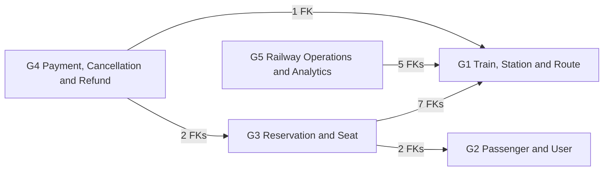
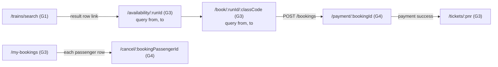
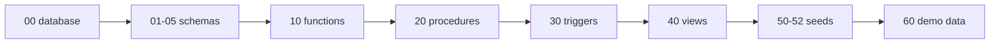

# Integration Mapping Document

**National Railway Reservation & Management System** — DBMS project, PICT (E&TCE)

| Item | Value |
|---|---|
| File | `docs/INTEGRATION_MAPPING.md` (task I2) |
| Repository | `railway-system` |
| Version / date | 1.0 / 2026-10-28 |
| Derived from | Master Prompt Part 2 contract (sections C1–C11) and hard rules R1–R18. Every row below cites its contract section; nothing is invented. |
| Approval | Team Leader 1 and Team Leader 2 (section i) |

## Contents

- [(a) Purpose](#a-purpose)
- [(b) Shared standards](#b-shared-standards)
- [(c) Table ownership matrix](#c-table-ownership-matrix)
- [(d) Cross-group foreign keys](#d-cross-group-foreign-keys)
- [(e) Cross-group SQL dependencies](#e-cross-group-sql-dependencies)
- [(f) Cross-group API and UI links](#f-cross-group-api-and-ui-links)
- [(g) Database build order and why](#g-database-build-order-and-why)
- [(h) Integration checklist](#h-integration-checklist)
- [(i) Sign-off](#i-sign-off)

---

## (a) Purpose

The system is built by five module groups and a few foundation/integration tasks. Each task is produced separately and the files are only joined in one Git repository at the end. The contract (C1–C11) fixes every name that crosses a task boundary. This document is the **single list of every point of contact between two groups**, so that:

1. each group knows exactly which objects of other groups it may read, call or fire;
2. both Team Leaders can check, before the project is demonstrated, that no group writes into another group's table except through the four exceptions in C11;
3. the faculty can see in one place how the five modules form one transactional system, and sign it off.

### Groups and modules

| Group | Name | Backend package | Frontend folder | Tables | Functions | Procedures | Triggers | Views |
|---|---|---|---|---|---|---|---|---|
| G1 | Train, Station & Route | `com.railway.train` | `src/modules/trains` | 10 | 3 | 2 | 2 | 2 |
| G2 | Passenger & User | `com.railway.user` | `src/modules/users` | 7 | 2 | 2 | 3 | 2 |
| G3 | Reservation & Seat | `com.railway.booking` | `src/modules/booking` | 5 | 2 | 3 | 4 | 2 |
| G4 | Payment, Cancellation & Refund | `com.railway.payment` | `src/modules/payments` | 7 | 3 | 3 | 3 | 2 |
| G5 | Railway Operations & Analytics | `com.railway.ops` | `src/modules/ops` | 3 | 1 | 2 | 3 | 4 |
| **Total** | | | | **32** | **11** | **12** | **15** | **12** |

### Foundation and integration tasks (not groups)

| Task | Creates | Used by |
|---|---|---|
| F1 | `backend/pom.xml`, `application.yml`, everything in `com.railway.common` (ApiResponse, ApiException, GlobalExceptionHandler, SqlHelper, JwtService, SecurityUtil, SecurityConfig, OtpVerifier interface, HealthController) | all five backends |
| F2 | the Vite/React project, `@/api/client`, `@/auth/AuthContext`, `@/hooks/useAsync`, `@/utils/format`, `@/components/ui`, `App.jsx`, `main.jsx`, Home page | all five frontends |
| F3 | `db/00_database.sql`, `scripts/init-db.ps1`, `scripts/init-db.sh`, `scripts/verify-contract.sql` | the whole database build |
| I1 | `db/60_demo_data.sql` | demo and viva |
| I2 | this document and `docs/ARCHITECTURE.md` | Team Leaders, faculty |

### How to read this document

- **READ** = SELECT only (allowed for any group; C3 restricts only writes). **WRITE** = INSERT/UPDATE/DELETE. **CALL** = invoke a function or procedure. **LOCK** = `SELECT ... FOR UPDATE` without changing the row. **FIRES** = the statement causes a trigger of another group to run.
- `C11-1` … `C11-4` refer to the four numbered items of contract section C11 (the only allowed cross-group writes).
- Rows marked *(implied)* are not written word-for-word in the contract but are forced by it (for example a page needs a value that only another group's endpoint returns). They are listed so that nobody is surprised by them.

---

## (b) Shared standards

### b.1 Naming conventions (C3)

| Item | Rule | Example |
|---|---|---|
| Database | `railway_db`, MySQL 8.0, InnoDB, utf8mb4 | |
| Tables | `snake_case`, singular | `booking_passenger` |
| Columns | `Pascal_Snake` | `Train_ID`, `Fare_Amount` |
| Primary key | `<Entity>_ID INT UNSIGNED AUTO_INCREMENT` | `Booking_ID` |
| Foreign key column | same name as the parent primary key unless the contract names it differently | `Run_ID` in `booking` |
| Status values | UPPER_CASE strings guarded by `CHECK` (never `ENUM`) | `PENDING_PAYMENT` |
| Procedures / functions / triggers / views | `sp_*` / `fn_*` / `trg_*` / `v_*` | `sp_book_ticket` |
| Indexes | `idx_<table>_<columns>` | `idx_train_run_journey_date` |
| Routine parameters | `p_<column in lower snake case>` | `p_run_id`, `p_class_code` |
| SQL files | `NN_kind_gN.sql`, run in numeric order, `g1..g5` inside a number | `20_procedures_g3.sql` |
| Java packages | `com.railway.{train\|user\|booking\|payment\|ops}` with sub-packages `controller`, `service`, `dto` | `com.railway.booking.controller` |
| Java class prefixes | G1 `Train*/Station*/Route*/Coach*`, G2 `Auth*/User*/Passenger*/Otp*`, G3 `Booking*/Availability*/Ticket*/Seat*`, G4 `Payment*/Fare*/Cancellation*/Refund*`, G5 `Ops*/Report*/Dashboard*` | avoids Spring bean-name clashes |
| Java types | INT UNSIGNED id → `Long`; DECIMAL → `BigDecimal`; TINYINT(1) → `boolean` in JSON | |
| Frontend | each module owns `src/modules/<folder>/routes.jsx`, `api.js`, `pages/*.jsx`; shared code only from `@/…` | |

### b.2 Identifier names that cross group boundaries

JSON key rule (R13): split the column name at `_`, lower-case every part, capitalise the first letter of every part except the first, join them. `Train_ID → trainId`, `Available_CNF → availableCnf`, `Max_RAC → maxRac`, `Distance_From_Source_Km → distanceFromSourceKm`. View columns follow the same rule (`Availability_Text → availabilityText`, `Current_Station_Name → currentStationName`).

| Concept | Column(s) | Type | JSON key(s) | Owner of the parent |
|---|---|---|---|---|
| Station | `Station_ID`; role names `Source_Station_ID`, `Dest_Station_ID`, `From_Station_ID`, `To_Station_ID`, `Current_Station_ID` | INT UNSIGNED | `stationId`; `sourceStationId`, `destStationId`, `fromStationId`, `toStationId`, `currentStationId` | G1 `station` |
| Route / route stop | `Route_ID` / `Route_Stop_ID` | INT UNSIGNED | `routeId` / `routeStopId` | G1 |
| Train | `Train_ID`; business key `Train_No` CHAR(5) | INT UNSIGNED | `trainId`, `trainNo` | G1 |
| Coach type | `Coach_Type_ID`; natural key `Class_Code` VARCHAR(3) (`SL`,`3A`,`2A`,`1A`,`CC`) | INT UNSIGNED / VARCHAR(3) | `coachTypeId`, `classCode` | G1 `coach_type` |
| Coach / seat | `Coach_ID` / `Seat_ID` | INT UNSIGNED | `coachId` / `seatId` | G1 |
| Run (one train on one date) | `Run_ID` | INT UNSIGNED | `runId` | G1 `train_run` |
| User / role | `User_ID` / `Role_ID`, `Role_Name` | INT UNSIGNED / VARCHAR(20) | `userId` / `roles[]` | G2 |
| Passenger | `Passenger_ID` | INT UNSIGNED | `passengerId` | G2 |
| OTP challenge | table PK `Otp_ID`; API name differs by endpoint | INT UNSIGNED | `challengeId` (login, verify-otp, payment-otp) and `otpChallengeId` (`POST /payments/orders`) | G2 |
| Booking / ticket number | `Booking_ID`; `PNR` CHAR(10) | INT UNSIGNED / CHAR(10) | `bookingId`, `pnr` | G3 |
| Booking line (one passenger on one booking) | `Booking_Passenger_ID` | INT UNSIGNED | `bookingPassengerId` | G3 |
| Seat inventory | `Inventory_ID`; counters `Available_CNF`, `RAC_Count`, `WL_Count`, `Max_RAC`, `Max_WL` | SMALLINT | `availableCnf`, `racCount`, `wlCount`, `maxRac`, `maxWl` | G3 |
| Payment | `Payment_ID`; `Gateway_Order_ID`; `Gateway_Payment_ID` | INT UNSIGNED / VARCHAR(60) | `paymentId`, `gatewayOrderId`, `razorpayPaymentId` (request of `/payments/verify`) | G4 |
| Cancellation / refund | `Cancellation_ID` / `Refund_ID` | INT UNSIGNED | `cancellationId` / `refundId` | G4 |
| Fare and concession rules | `Fare_Rule_ID` / `Concession_Rule_ID` | INT UNSIGNED | `fareRuleId` / `concessionRuleId` | G4 |

Two traps to remember: (1) `Class_Code` (not `Coach_Type_ID`) is the key used in `seat_inventory`, `booking` and `fare_rule`; (2) the OTP challenge id has the JSON name `challengeId` in G2 responses but `otpChallengeId` in the G4 request body.

### b.3 Formats (R13)

| Kind | Format |
|---|---|
| Date | `yyyy-MM-dd` (e.g. `2026-10-27`) |
| Time | `HH:mm:ss` |
| Date-time | ISO-8601 |
| Money | JSON number (DECIMAL → `BigDecimal`) |
| Booleans | `true` / `false` (from TINYINT(1)) |
| API base | `/api/v1` (frontend dev server proxies `/api` to `http://localhost:8080`) |
| ISO weekday | 1 = Mon … 7 = Sun = `WEEKDAY(date)+1` (`train_schedule.Day_Of_Week`) |

### b.4 Shared status and code vocabularies

| Vocabulary | Allowed values | Written by | Read by |
|---|---|---|---|
| `booking.Booking_Status` | `PENDING_PAYMENT` (default), `CONFIRMED`, `CANCELLED`, `EXPIRED` | G3, G4 (C11-1, C11-2) | G2 view, G4, G5 |
| `booking_passenger.Status` | `CNF`, `RAC`, `WL`, `CANCELLED` | G3, G4 (C11-2) | G2 view, G3 triggers, G4 |
| `payment.Payment_Status` | `CREATED` (default), `SUCCESS`, `FAILED` | G4 | G5 |
| `payment.Payment_Mode` | `RAZORPAY`, `MOCK` | G4 | G4 |
| `refund.Refund_Status` | `PROCESSED` (default), `PENDING` | G4 | G4 |
| `train_run_status.Status` | `SCHEDULED` (default), `ON_TIME`, `DELAYED`, `CANCELLED`, `ARRIVED` | G5 | G5 |
| `role.Role_Name` | `PASSENGER`, `ADMIN`, `OPERATOR` | G2 | all (JWT claim `roles`) |
| `passenger.Concession_Type` (declared) | `NONE`, `GOVT`, `SOLDIER` | G2 | G3 |
| effective concession (`fn_effective_concession`) | `NONE`, `GOVT`, `SOLDIER`, `SENIOR`, `CHILD` | G2 (function) | G3, G4 |
| `concession_rule.Concession_Type` | `NONE`, `SENIOR`, `GOVT`, `SOLDIER`, `CHILD` | G4 | G4 (`fn_net_fare`) |
| `coach_type.Class_Code` | `SL`, `3A`, `2A`, `1A`, `CC` | G1 | G3, G4 |
| `train.Train_Type` | `EXPRESS`, `SUPERFAST`, `RAJDHANI`, `SHATABDI`, `LOCAL` | G1 | G3, G5 |
| `fn_age_category` | `CHILD` (age < 12), `ADULT`, `SENIOR` (age ≥ 60) | G2 | G2 |
| `fn_availability_text` | `AVL n`, `RAC n`, `WL n`, `REGRET` | G3 | G3 |

The declared `Concession_Type` of a passenger can never be `SENIOR` or `CHILD`; those two are derived from the date of birth by `fn_effective_concession` and priced through `concession_rule`.

### b.5 Error codes (C7)

SQL business errors use `SIGNAL SQLSTATE '45000' SET MESSAGE_TEXT = 'ERROR_CODE: readable text'` (R8). `GlobalExceptionHandler` (F1) walks the cause chain, finds the `SQLException` with SQLState `45000`, reads the code before the colon and maps it to the HTTP status below. Only these 26 codes exist.

| Code | HTTP | Raised by (contract source) |
|---|---|---|
| `VALIDATION_ERROR` | 400 | `sp_generate_train_runs` (G1), `trg_route_stop_bi` (G1), `trg_passenger_bi` (G2), `sp_book_ticket` passenger count (G3), bean validation in every backend |
| `INVALID_STATIONS` | 400 | `sp_book_ticket` (G3) |
| `TOO_MANY_PASSENGERS` | 400 | `sp_book_ticket` (G3) |
| `INVALID_STATUS` | 400 | `sp_update_train_status` (G5) |
| `INVALID_CREDENTIALS` | 401 | `POST /auth/login` (G2) |
| `UNAUTHORIZED` | 401 | `SecurityConfig` entry point (F1) |
| `OTP_INVALID` | 401 | `POST /auth/verify-otp` (G2); `POST /payments/orders` (G4) when `OtpVerifier.verify` returns false |
| `FORBIDDEN` | 403 | access denied from `SecurityConfig` / `@PreAuthorize` (F1) |
| `NOT_OWNER` | 403 | `sp_create_payment`, `sp_cancel_ticket` (G4); `/passengers/{id}` (G2) |
| `PASSENGER_NOT_OWNED` | 403 | `sp_book_ticket` (G3); `GET /fares/quote` (G4): C9 says passengers must belong to the user but names no code, so the only fitting C7 code is used |
| `NOT_FOUND` | 404 | `sp_add_coaches_generate_seats`, `sp_generate_train_runs` (G1); missing resources in any backend |
| `RUN_NOT_FOUND` | 404 | `sp_book_ticket` (G3), `sp_update_train_status` (G5) |
| `BOOKING_NOT_FOUND` | 404 | `sp_create_payment`, `sp_cancel_ticket` (G4) |
| `EMAIL_EXISTS` | 409 | `sp_register_user` (G2) |
| `DUPLICATE` | 409 | `DuplicateKeyException` mapped in F1 |
| `CONSTRAINT_VIOLATION` | 409 | `DataIntegrityViolationException` mapped in F1 (e.g. deleting a station that a booking still references, see section d) |
| `PASSENGER_IN_USE` | 409 | `DELETE /passengers/{id}` (G2) |
| `SEAT_UNAVAILABLE` | 409 | `sp_book_ticket` (G3) when no inventory row exists |
| `BOOKING_CLOSED_WL_FULL` | 409 | `trg_block_if_wl_full` (G3) during `sp_book_ticket` |
| `RUN_DEPARTED` | 409 | `sp_book_ticket` (G3) |
| `ALREADY_CANCELLED` | 409 | `sp_cancel_ticket` (G4) |
| `CANCEL_NOT_ALLOWED` | 409 | `sp_cancel_ticket` (G4) when hours before departure < 0 |
| `PAYMENT_NOT_ALLOWED` | 409 | `sp_create_payment`, `sp_confirm_payment` (G4) |
| `REFUND_EXCEEDS_FARE` | 409 | `trg_refund_check` (G4) |
| `ACCOUNT_LOCKED` | 423 | `POST /auth/login` (G2) |
| `INTERNAL_ERROR` | 500 | fallback in F1 (logged, generic message) |

### b.6 Response format (C7, C8)

Success:

```json
{ "success": true, "data": { "bookingId": 12, "pnr": "4839201756", "totalFare": 480.00 } }
```

Failure (also used for 401 and 403 produced by Spring Security):

```json
{ "success": false, "error": { "code": "SEAT_UNAVAILABLE", "message": "readable text" } }
```

- Java: `ApiResponse<T>(success, data, error)` with `ApiResponse.ok(T)` / `ApiResponse.fail(code, msg)`; `ApiError(code, message)`.
- Controllers return `ApiResponse<List<Map<String,Object>>>` for view-backed endpoints; rows come from `SqlHelper` with lowerCamelCase keys.
- Access levels used in the API table: `PUBLIC`, `AUTH` (any logged-in user), `ADMIN`, `OPERATOR` (OPERATOR or ADMIN, via `@PreAuthorize("hasAnyRole('OPERATOR','ADMIN')")`).

### b.7 Rules every group follows (R5–R12)

| Rule | Meaning at the group boundary |
|---|---|
| R5 | SQL files are re-runnable: `DROP … IF EXISTS` before routines/triggers, `CREATE OR REPLACE VIEW`; no `USE` / `CREATE DATABASE` (F3's init script does that); first line is a comment with task id, owner group and purpose |
| R6 | every function is declared `DETERMINISTIC` or `NOT DETERMINISTIC` + `NO SQL` / `READS SQL DATA` exactly as in C5.1 |
| R7 | non-helper procedures own their transaction (`EXIT HANDLER … ROLLBACK; RESIGNAL`, `START TRANSACTION … COMMIT`) and return exactly one result set; the only HELPER is `sp_promote_rac_wl` (no transaction, no result set, OUT parameter) |
| R9 | `seat_inventory` counters change **only** through triggers; procedures change `booking_passenger.Status` |
| R10 | lock order everywhere: `seat_inventory` → `booking` → `booking_passenger` → `seat_allocation` / `payment` |
| R12 | a Spring service method that CALLs a non-helper procedure is **not** `@Transactional` |

---

## (c) Table ownership matrix

Owner = the only group whose procedures, triggers and backend may write the table, except where the last column lists a C11 exception. "Readers" lists the **other** groups that read the table; "(via fn_…)" means the read happens inside a function of the owner group that another group calls.

| # | Table | Owner | Readers (other groups) | Allowed writers | C11 exceptions |
|---|---|---|---|---|---|
| 1 | `station` | G1 | G2 (`v_passenger_booking_history`), G3 (FKs, booking/ticket station codes), G5 (`v_train_live_status`, `v_station_daily_revenue`, FKs) | G1 (admin station API, `50_seed_g1.sql`) | none |
| 2 | `route` | G1 | G5 (`v_popular_routes`) | G1 (admin routes API, seed) | none |
| 3 | `route_stop` | G1 | G3 (`sp_book_ticket` INVALID_STATIONS check); G3/G4 via `fn_distance_km`, `fn_departure_datetime` | G1 (admin routes API, `PUT /admin/route-stops/{id}`, seed) | none |
| 4 | `train` | G1 | G2 (`v_passenger_booking_history`), G3 (`v_seat_availability`, `v_run_occupancy`, bookings, tickets), G5 (`v_train_live_status`, `v_delay_metrics`, `v_popular_routes`, dashboard) | G1 (admin trains API, seed) | none |
| 5 | `train_schedule` | G1 | none | G1 (admin trains API, seed) | none |
| 6 | `coach_type` | G1 | G3 (FK from `seat_inventory`, `trg_run_init_inventory`), G4 (FK from `fare_rule`) | G1 (seed) | none |
| 7 | `train_coach` | G1 | G3 (`trg_run_init_inventory`, seat allocation, seat map) | G1 (`sp_add_coaches_generate_seats`) | none |
| 8 | `seat` | G1 | G3 (FK from `seat_allocation`, allocation, seat map, tickets) | G1 (`sp_add_coaches_generate_seats`) | none |
| 9 | `train_run` | G1 | G2 (`v_passenger_booking_history`), G3 (FKs, views, `sp_book_ticket`), G4 (via `fn_departure_datetime` in `sp_cancel_ticket`), G5 (FKs, views) | G1 (`sp_generate_train_runs`, seed) | none (the G3 and G5 triggers on this table only write their own tables, C11-3) |
| 10 | `route_stop_audit` | G1 | none | G1 (`trg_route_stop_audit`) | none |
| 11 | `role` | G2 | none (role names travel in the JWT) | G2 (`51_seed_g2.sql`) | none |
| 12 | `app_user` | G2 | G3 (FK from `booking.User_ID`) | G2 (`sp_register_user`, `sp_record_login_attempt`, user API, seed) | none |
| 13 | `user_role` | G2 | none | G2 (`sp_register_user`, admin roles API, seed) | none |
| 14 | `passenger` | G2 | G3 (`sp_book_ticket`, booking responses, FK from `booking_passenger`), G4 (`GET /fares/quote` ownership check, `v_refund_summary` Passenger_Name) | G2 (passenger API, seed) | none |
| 15 | `login_audit` | G2 | none | G2 (`sp_record_login_attempt`) | none |
| 16 | `user_role_audit` | G2 | none | G2 (`trg_user_role_ai`, `trg_user_role_ad`) | none |
| 17 | `otp_challenge` | G2 | none (G4 reaches OTP only through the `OtpVerifier` interface) | G2 (`OtpVerifierImpl`, auth API) | none |
| 18 | `seat_inventory` | G3 | G4 (`sp_cancel_ticket` LOCKs the row), G3 views | G3 **triggers only**: `trg_run_init_inventory`, `trg_dec_inventory`, `trg_adjust_inventory_on_status` (R9) | none (C11-3 is the G3 trigger writing its own table) |
| 19 | `booking` | G3 | G2 (`v_passenger_booking_history`), G4 (`sp_create_payment`, `sp_cancel_ticket`, `v_payment_history`, `v_refund_summary`, FK from `payment`), G5 (`v_station_daily_revenue`, `v_popular_routes`, `sp_generate_daily_revenue`, dashboard) | G3 (`sp_book_ticket`, `sp_expire_unpaid_bookings`) | **C11-1** G4 `trg_payment_confirm` sets `Booking_Status` = CONFIRMED; **C11-2** G4 `sp_cancel_ticket` sets `Booking_Status` = CANCELLED |
| 20 | `booking_passenger` | G3 | G2 (`v_passenger_booking_history`; `PASSENGER_IN_USE` check on `DELETE /passengers/{id}`), G4 (`sp_cancel_ticket`, `v_refund_summary`, cancellation preview, FK from `cancellation`) | G3 (`sp_book_ticket` INSERT, `sp_promote_rac_wl` and `sp_expire_unpaid_bookings` UPDATE Status) | **C11-2** G4 `sp_cancel_ticket` sets `Status` = CANCELLED |
| 21 | `seat_allocation` | G3 | none | G3 (`sp_book_ticket`, `sp_promote_rac_wl` INSERT; `sp_expire_unpaid_bookings` DELETE) | **C11-2** G4 `sp_cancel_ticket` deletes rows |
| 22 | `booking_status_history` | G3 | none | G3 (`trg_adjust_inventory_on_status`) | none |
| 23 | `fare_rule` | G4 | G3 (via `fn_base_fare` in `sp_book_ticket`) | G4 (`PUT /admin/fare-rules/{id}`, `52_seed_g4.sql`) | none |
| 24 | `concession_rule` | G4 | G3 (via `fn_net_fare` in `sp_book_ticket`) | G4 (`PUT /admin/concession-rules/{id}`, seed) | none |
| 25 | `refund_rule` | G4 | none | G4 (seed) | none |
| 26 | `payment` | G4 | G5 (`v_station_daily_revenue`, `sp_generate_daily_revenue`, dashboard `totalRevenue`) | G4 (`sp_create_payment`, `sp_confirm_payment`) | none |
| 27 | `cancellation` | G4 | G5 (dashboard `cancellationsToday`) | G4 (`sp_cancel_ticket`) | none |
| 28 | `refund` | G4 | none | G4 (`sp_cancel_ticket`) | none |
| 29 | `fare_audit_log` | G4 | none | G4 (`trg_fare_audit`) | none |
| 30 | `train_run_status` | G5 | none | G5 (`trg_run_init_status` INSERT, `sp_update_train_status` UPDATE; `trg_status_flag` adjusts the NEW row) | none (C11-3 is the G5 trigger writing its own table) |
| 31 | `delay_log` | G5 | none | G5 (`trg_delay_log`) | none |
| 32 | `station_daily_revenue` | G5 | none | G5 (`sp_generate_daily_revenue`) | none |

Notes

1. **Backends never write another group's tables** (C11-4). A backend that needs a change in another group's data calls the owner's procedure or the owner's endpoint.
2. **Seed and demo files.** `50_seed_g1.sql`, `51_seed_g2.sql` and `52_seed_g4.sql` insert only into their own group's tables. `50_seed_g1.sql` also CALLs G1's procedures, whose `train_run` inserts fire the G3 and G5 triggers (section e). `60_demo_data.sql` (I1) creates data only by CALLing procedures (`sp_book_ticket`, `sp_create_payment`, `sp_confirm_payment`, `sp_cancel_ticket`), so every cross-group write there still goes through the owners' code.
3. **G3 and G5 have no seed file** (C1); their rows are created by triggers (`seat_inventory`, `train_run_status`) or by bookings and operations.
4. **`sp_promote_rac_wl` is G3 code running inside a G4 transaction.** Its writes to `booking_passenger` and `seat_allocation` are therefore G3 writes, called through the C11-2 exception.

---

## (d) Cross-group foreign keys

Every foreign key whose parent table belongs to a different group than the child table. **17 rows.** Every one has `ON DELETE RESTRICT` (a parent row cannot be deleted while a child row points to it).

| # | Child table.column | Parent table.column | Child owner | Parent owner | ON DELETE |
|---|---|---|---|---|---|
| 1 | `seat_inventory.Run_ID` | `train_run.Run_ID` | G3 | G1 | RESTRICT |
| 2 | `seat_inventory.Class_Code` | `coach_type.Class_Code` (UNIQUE) | G3 | G1 | RESTRICT |
| 3 | `booking.User_ID` | `app_user.User_ID` | G3 | G2 | RESTRICT |
| 4 | `booking.Run_ID` | `train_run.Run_ID` | G3 | G1 | RESTRICT |
| 5 | `booking.From_Station_ID` | `station.Station_ID` | G3 | G1 | RESTRICT |
| 6 | `booking.To_Station_ID` | `station.Station_ID` | G3 | G1 | RESTRICT |
| 7 | `booking_passenger.Passenger_ID` | `passenger.Passenger_ID` | G3 | G2 | RESTRICT |
| 8 | `seat_allocation.Run_ID` | `train_run.Run_ID` | G3 | G1 | RESTRICT |
| 9 | `seat_allocation.Seat_ID` | `seat.Seat_ID` | G3 | G1 | RESTRICT |
| 10 | `fare_rule.Class_Code` | `coach_type.Class_Code` (UNIQUE) | G4 | G1 | RESTRICT |
| 11 | `payment.Booking_ID` | `booking.Booking_ID` | G4 | G3 | RESTRICT |
| 12 | `cancellation.Booking_Passenger_ID` | `booking_passenger.Booking_Passenger_ID` | G4 | G3 | RESTRICT |
| 13 | `train_run_status.Run_ID` | `train_run.Run_ID` | G5 | G1 | RESTRICT |
| 14 | `train_run_status.Current_Station_ID` (nullable) | `station.Station_ID` | G5 | G1 | RESTRICT |
| 15 | `delay_log.Run_ID` | `train_run.Run_ID` | G5 | G1 | RESTRICT |
| 16 | `delay_log.Station_ID` (nullable) | `station.Station_ID` | G5 | G1 | RESTRICT |
| 17 | `station_daily_revenue.Station_ID` | `station.Station_ID` | G5 | G1 | RESTRICT |

Per child group: G3 → G1 (7 FKs: rows 1, 2, 4, 5, 6, 8, 9) and G2 (2 FKs: rows 3, 7); G4 → G1 (1 FK: row 10) and G3 (2 FKs: rows 11, 12); G5 → G1 (5 FKs: rows 13–17). G1 and G2 have **no** cross-group foreign key.



*An arrow means "the child group has foreign keys that point into the parent group".*

Consequences

- The FK graph has no cycle, and the group numbers G1 … G5 are already a valid creation order (G1 and G2 first, then G3, then G4 and G5). This is why schema files `01` … `05` can run in plain numeric order.
- Because of RESTRICT, a G1 admin who deletes a station, or a G2 user who deletes a passenger, that is still referenced by a booking, payment or log row gets a database error. The backend maps it to `CONSTRAINT_VIOLATION` (HTTP 409); `DELETE /passengers/{id}` reports `PASSENGER_IN_USE`.
- **Logical references without a foreign key** all stay inside one group and are not cross-group: `route_stop_audit.Route_Stop_ID` (G1), `login_audit.User_ID`, `user_role_audit.User_ID/Role_ID` (G2), `booking_status_history.Booking_Passenger_ID` (G3), `fare_audit_log.Fare_Rule_ID` (G4). `booking.Class_Code` is also a plain column (no FK) and is checked by the booking procedure through `seat_inventory`.

---

## (e) Cross-group SQL dependencies

Every function, procedure, trigger and view of one group that reads, writes, calls or fires objects of another group. Objects not listed here depend only on their own group's objects.

### e.1 Functions called by another group

| # | Function (owner) | Called by | Caller group | Purpose |
|---|---|---|---|---|
| 1 | `fn_distance_km` (G1) | `sp_book_ticket`; `GET /fares/quote` | G3; G4 | distance between the two stations of a run, input of the base fare |
| 2 | `fn_departure_datetime` (G1) | `sp_book_ticket`; `sp_cancel_ticket`; `GET /cancellations/preview` *(implied by `hoursBeforeDeparture`)* | G3; G4; G4 | `RUN_DEPARTED` check; hours before departure for the refund percentage |
| 3 | `fn_effective_concession` (G2) | `sp_book_ticket`; `GET /fares/quote` | G3; G4 | derives SENIOR / CHILD from date of birth, otherwise the declared type |
| 4 | `fn_base_fare` (G4) | `sp_book_ticket` | G3 | fare from distance and class using `fare_rule` |
| 5 | `fn_net_fare` (G4) | `sp_book_ticket` | G3 | fare after the concession discount using `concession_rule` |

The other six functions are used inside their own group only: `fn_journey_duration_min` (G1, `/trains/search`), `fn_age_category` (G2, `GET /passengers`), `fn_generate_pnr` and `fn_availability_text` (G3), `fn_refund_deduction_pct` (G4, `sp_cancel_ticket` and the preview), `fn_delay_minutes` (G5; the contract names no caller). **No function body reads another group's table**: `fn_distance_km`, `fn_departure_datetime`, `fn_journey_duration_min` read only G1 tables; `fn_base_fare`, `fn_net_fare`, `fn_refund_deduction_pct` read only G4 tables.

### e.2 Stored procedures

| # | Procedure (owner) | Other-group object | Object owner | Access | Why (contract) |
|---|---|---|---|---|---|
| 1 | `sp_generate_train_runs` (G1) | `trg_run_init_inventory` → `seat_inventory` | G3 | FIRES, then WRITE by the trigger (C11-3) | creating a run must create one inventory row per class; coaches must already exist |
| 2 | `sp_generate_train_runs` (G1) | `trg_run_init_status` → `train_run_status` | G5 | FIRES, then WRITE by the trigger (C11-3) | every run gets a `SCHEDULED` status row |
| 3 | `sp_book_ticket` (G3) | `train_run`, `train` | G1 | READ | run exists (`RUN_NOT_FOUND`), train's route |
| 4 | `sp_book_ticket` (G3) | `route_stop` | G1 | READ | both stations on the route and `Stop_Seq(from) < Stop_Seq(to)` (`INVALID_STATIONS`) |
| 5 | `sp_book_ticket` (G3) | `fn_departure_datetime` | G1 | CALL | departure must be after `NOW()` (`RUN_DEPARTED`) |
| 6 | `sp_book_ticket` (G3) | `fn_distance_km` | G1 | CALL | distance per passenger |
| 7 | `sp_book_ticket` (G3) | `seat`, `train_coach`, `coach_type` | G1 | READ | lowest free `Seat_ID` of that class on the train |
| 8 | `sp_book_ticket` (G3) | `passenger` | G2 | READ | ownership (`PASSENGER_NOT_OWNED`), date of birth, declared concession |
| 9 | `sp_book_ticket` (G3) | `fn_effective_concession` | G2 | CALL | concession type per passenger |
| 10 | `sp_book_ticket` (G3) | `fn_base_fare`, `fn_net_fare` | G4 | CALL | base fare and net fare per passenger |
| 11 | `sp_promote_rac_wl` (G3) | `seat`, `train_coach`, `coach_type` | G1 | READ | choose the lowest free seat when an RAC passenger becomes CNF |
| 12 | `sp_create_payment` (G4) | `booking` | G3 | READ | exists, owned by the user, `PENDING_PAYMENT`, amount = `Total_Fare` |
| 13 | `sp_confirm_payment` (G4) | `booking` | G3 | READ (result set) and indirect WRITE through `trg_payment_confirm` (C11-1) | returns `Booking_Status` after a successful payment |
| 14 | `sp_cancel_ticket` (G4) | `booking_passenger` | G3 | READ, LOCK, UPDATE `Status` (C11-2) | existence, status, cancellation |
| 15 | `sp_cancel_ticket` (G4) | `booking` | G3 | READ owner / status, UPDATE `Booking_Status` (C11-2) | `NOT_OWNER`, paid or unpaid, set CANCELLED when all passengers are cancelled |
| 16 | `sp_cancel_ticket` (G4) | `seat_inventory` | G3 | LOCK (`FOR UPDATE`), no write | first lock of the transaction (R10); counters move through trigger #20 below |
| 17 | `sp_cancel_ticket` (G4) | `seat_allocation` | G3 | DELETE (C11-2) | releases the cancelled passenger's seat |
| 18 | `sp_cancel_ticket` (G4) | `sp_promote_rac_wl` | G3 | CALL (C11-2) | automatic RAC → CNF and WL → RAC promotion |
| 19 | `sp_cancel_ticket` (G4) | `fn_departure_datetime` | G1 | CALL | hours before departure |
| 20 | `sp_cancel_ticket` (G4) | `trg_adjust_inventory_on_status` | G3 | FIRES on the `Status` update | counter arithmetic and `booking_status_history` row |
| 21 | `sp_update_train_status` (G5) | `station` | G1 | FK check on `Current_Station_ID` | the current station must exist (or be NULL) |
| 22 | `sp_generate_daily_revenue` (G5) | `payment` | G4 | READ | successful payments of the day (`Payment_Status` = SUCCESS, `DATE(Paid_At)`) |
| 23 | `sp_generate_daily_revenue` (G5) | `booking` | G3 | READ | origin station (`From_Station_ID`) of each paid booking |
| 24 | `sp_generate_daily_revenue` (G5) | `station` | G1 | FK check | `station_daily_revenue.Station_ID` |

Procedures with no cross-group access in their own body: `sp_add_coaches_generate_seats` (G1), `sp_register_user`, `sp_record_login_attempt` (G2), `sp_expire_unpaid_bookings` (G3; it calls only G3's own `sp_promote_rac_wl`, but it races with G4 payments, see h.9).

### e.3 Triggers

| # | Trigger (owner) | Table it sits on (owner) | Cross-group effect | Contract basis |
|---|---|---|---|---|
| 1 | `trg_run_init_inventory` (G3) | `train_run` (G1), AFTER INSERT | READs `train_coach`, `coach_type` (G1); INSERTs `seat_inventory` (G3) | C5.3, C11-3 |
| 2 | `trg_run_init_status` (G5) | `train_run` (G1), AFTER INSERT | INSERTs `train_run_status` (G5) | C5.3, C11-3 |
| 3 | `trg_payment_confirm` (G4) | `payment` (G4), AFTER UPDATE | UPDATEs `booking.Booking_Status` (G3) to CONFIRMED when the payment becomes SUCCESS | C5.3, C11-1 |
| 4 | `trg_adjust_inventory_on_status` (G3) | `booking_passenger` (G3), AFTER UPDATE | fired by G4's `sp_cancel_ticket`; it is G3 code, so the writes to `seat_inventory` and `booking_status_history` are G3 writes | C5.3, C11-2 |

Triggers that touch only their own group's tables: `trg_route_stop_audit`, `trg_route_stop_bi` (G1); `trg_user_role_ai`, `trg_user_role_ad`, `trg_passenger_bi` (G2); `trg_block_if_wl_full`, `trg_dec_inventory` (G3); `trg_fare_audit`, `trg_refund_check` (G4); `trg_status_flag`, `trg_delay_log` (G5).

### e.4 Views

| # | View (owner) | Other-group objects read | Owners |
|---|---|---|---|
| 1 | `v_passenger_booking_history` (G2) | `booking`, `booking_passenger` | G3 |
| 2 | | `train_run`, `train`, `station` (Train_No, Train_Name, Journey_Date, From/To_Station_Code) | G1 |
| 3 | `v_seat_availability` (G3) | `train_run`, `train` (G1); `fn_availability_text` is G3's own | G1 |
| 4 | `v_run_occupancy` (G3) | `train_run`, `train` | G1 |
| 5 | `v_payment_history` (G4) | `booking` (User_ID, PNR) | G3 |
| 6 | `v_refund_summary` (G4) | `booking_passenger`, `booking` (PNR, User_ID) | G3 |
| 7 | | `passenger` (Passenger_Name) | G2 |
| 8 | `v_train_live_status` (G5) | `train_run`, `train`, `station` (Current_Station_Name) | G1 |
| 9 | `v_station_daily_revenue` (G5) | `payment` | G4 |
| 10 | | `booking` (From_Station_ID) | G3 |
| 11 | | `station` | G1 |
| 12 | `v_popular_routes` (G5) | `booking` (counted when status is not EXPIRED) | G3 |
| 13 | | `train_run`, `train`, `route` | G1 |
| 14 | `v_delay_metrics` (G5) | `train_run`, `train` | G1 |

Views of G1 (`v_train_timetable`, `v_train_stop_pairs`) and G2 (`v_user_account`) read only their own group's tables. **Circular read dependency:** G2's `v_passenger_booking_history` reads G3 tables while G3's `booking` has foreign keys into G2. This is why no view may be created before *all* schemas exist (section g).

### e.5 Backend SQL that reads other groups' data (read-only, C11-4)

| # | Endpoint (owner) | Reads from | Why |
|---|---|---|---|
| 1 | `DELETE /passengers/{id}` (G2) | `booking_passenger` (G3) | answer `PASSENGER_IN_USE` instead of a raw FK error |
| 2 | `POST /bookings`, `GET /bookings/my`, `GET /bookings/{id}`, `GET /tickets/{pnr}`, `GET /runs/{runId}/seat-map` (G3) | `train`, `train_run`, `station`, `seat`, `train_coach`, `coach_type` (G1); `passenger` (G2) | build the response fields (train name, station codes, coach number, seat number, berth type, passenger name) |
| 3 | `GET /fares/quote` (G4) | `passenger` (G2), functions of G1 and G2 | ownership check and per-passenger concession |
| 4 | `GET /cancellations/preview`, `POST /cancellations` (G4) | `booking_passenger`, `booking` (G3) | fare, owner, departure |
| 5 | `GET /admin/dashboard/summary`, reports (G5) | `booking` (G3), `payment`, `cancellation` (G4), `train`, `station` (G1) | totals and "today" counters |

---

## (f) Cross-group API and UI links

### f.1 Navigation flow (C10)



| # | From page (group) | To page (group) | Trigger | Data handed over |
|---|---|---|---|---|
| 1 | `/trains/search` (G1) | `/availability/:runId` (G3) | search result row | `runId` in the path; `from` and `to` station ids in the query |
| 2 | `/availability/:runId` (G3) | `/book/:runId/:classCode` (G3) | class selected | `runId`, `classCode`; `from`, `to` in the query |
| 3 | `/book/:runId/:classCode` (G3) | `/payment/:bookingId` (G4) | `POST /bookings` succeeds | `bookingId` |
| 4 | `/payment/:bookingId` (G4) | `/tickets/:pnr` (G3) | payment success | `pnr` |
| 5 | `/my-bookings` (G3) | `/cancel/:bookingPassengerId` (G4) | passenger row link | `bookingPassengerId` |
| 6 | any page (F2 client) | `/login` (G2) | HTTP 401 | token cleared by `@/api/client` |

### f.2 Cross-group API calls made by pages

| # | Page (group) | API call | API owner | Basis |
|---|---|---|---|---|
| 1 | `/book/:runId/:classCode` (G3) | `GET /passengers` | G2 | choose passengers; explicit in the task description |
| 2 | `/book/:runId/:classCode` (G3) | `GET /fares/quote?runId&classCode&fromStationId&toStationId&passengerIds=1,2` | G4 | show fare before booking; explicit in the task description |
| 3 | `/book/:runId/:classCode` (G3) | `POST /bookings` | G3 | own endpoint |
| 4 | `/payment/:bookingId` (G4) | `POST /auth/payment-otp` | G2 | payment OTP (2FA) when `app.auth.require-payment-otp=true`; explicit in the task description |
| 5 | `/payment/:bookingId` (G4) | `POST /payments/orders` with `otpChallengeId`, `otp` | G4 | own endpoint (verifies the OTP through `OtpVerifier`, G2) |
| 6 | `/payment/:bookingId` (G4) | `POST /payments/mock-confirm` (MOCK) or `POST /payments/verify` (RAZORPAY) | G4 | own endpoints |
| 7 | `/payment/:bookingId` (G4) | `GET /bookings/{bookingId}` | G3 | *(implied)* the page receives only `bookingId`, and neither payment-confirmation response contains the `pnr` needed for `/tickets/:pnr` |
| 8 | `/ops/update` (G5) | `GET /stations` | G1 | *(implied)* `PUT /ops/status/{runId}` needs a `currentStationId` |
| 9 | `/my-bookings` (G3) | `GET /bookings/my` | G3 | own endpoint; rows carry `bookingPassengerId` for the cancel link |
| 10 | `/cancel/:bookingPassengerId` (G4) | `GET /cancellations/preview`, `POST /cancellations` | G4 | own endpoints; the cancellation changes G3 data |
| 11 | `/payments/history` (G4) | `GET /payments/my`, `GET /refunds/my` | G4 | own endpoints |

### f.3 Backend-to-backend (Java) links

| # | Consumer | Provider | Mechanism |
|---|---|---|---|
| 1 | G4 payment service (`POST /payments/orders`) | G2 `com.railway.user.service.OtpVerifierImpl` | interface `common.otp.OtpVerifier.verify(userId, purpose, challengeId, otp)` with purpose `PAYMENT`; the only Java-level coupling between groups |
| 2 | every group | F1 `com.railway.common` | `SqlHelper`, `ApiResponse`, `ApiException`, `SecurityUtil`, `JwtService` |
| 3 | G3, G4 services | stored procedures of G3/G4 | `sql.call("CALL …")`, service method **not** `@Transactional` (R12) |
| 4 | G5 `PUT /ops/status/{runId}` | MongoDB `ops_event_log` | written after `sp_update_train_status` succeeds, only when `app.mongo.enabled=true`; Mongo errors never fail the request |

### f.4 Shared URL space and access rules

Groups share URL prefixes. Two controllers must never map the same HTTP method and full path.

| Prefix | Used by | Notes |
|---|---|---|
| `/runs/**` | G1 (`GET /runs/{runId}`), G3 (`GET /runs/{runId}/seat-map`) | different full paths, both PUBLIC |
| `/trains/**` | G1 (`/trains`, `/trains/{id}`, `/trains/search`, `/trains/{id}/timetable`, `/coaches`, `/runs`) | `search` is a literal path and must not be captured by `{id}` |
| `/bookings/**` | G3 (`/bookings`, `/bookings/my`, `/bookings/{bookingId}`) | `my` is a literal path |
| `/admin/**` | all five groups | the whole prefix needs role ADMIN in `SecurityConfig` |
| `/auth/**` | G2 | `register`, `login`, `verify-otp` are PUBLIC; `payment-otp` needs login (G4's payment page calls it) |
| `/payments/**`, `/refunds/**`, `/fares/**`, `/cancellations/**` | G4 | all need login |
| `/availability`, `/tickets/**` | G3 | PUBLIC |
| `/ops/**` | G5 | GET is PUBLIC; `PUT /ops/status/{runId}` needs login and `@PreAuthorize("hasAnyRole('OPERATOR','ADMIN')")` |

`SecurityConfig` (F1) makes these GET paths public: `/api/v1/{stations,routes,coach-types,trains,runs,availability,tickets,ops}/**` and `/api/v1/health`; `POST /api/v1/auth/{register,login,verify-otp}` are public; `/api/v1/admin/**` needs ADMIN; everything else needs a valid JWT.

### f.5 Data effects visible across groups

| Action (group) | Effect seen by another group |
|---|---|
| successful payment (G4) | booking becomes `CONFIRMED` in `GET /bookings/{id}`, `GET /tickets/{pnr}` and `v_passenger_booking_history` (G3, G2) |
| ticket cancellation (G4) | passenger `CANCELLED`, seat released, inventory counters change, next RAC/WL passengers are promoted (G3 data and availability) |
| run generation (G1) | `seat_inventory` rows appear (G3) and `train_run_status` rows appear (G5) |
| fare rule change (G4) | `trg_fare_audit` logs it; the next `sp_book_ticket` (G3) prices with the new rate |
| train status update (G5) | `v_train_live_status` and `/ops/board` change; Mongo event when enabled |

---

## (g) Database build order and why

Order = numeric file order; inside one number, `g1 … g5`. Tests under `db/tests/` are outside the numeric sequence and are run on demand after the build.



| Step | Files | Owner | Why it is here |
|---|---|---|---|
| 1 | `00_database.sql` | F3 | drops and creates `railway_db`; the init script runs `USE railway_db`, so no other file contains `USE` or `CREATE DATABASE` (R5) |
| 2 | `01_schema_g1.sql` … `05_schema_g5.sql` | G1 … G5 | all 32 tables first. Foreign keys need the parent table to exist: G3 points to G1 and G2, G4 to G1 and G3, G5 to G1 (section d), so group order is a valid order. Creating **all** schemas before any routine also means every later file sees every table |
| 3 | `10_functions_g1.sql` … `g5` | G1 … G5 | functions are used by procedures (`sp_book_ticket` uses G1, G2, G4 functions; `sp_cancel_ticket` uses G1 and G4 functions) and by views (`v_seat_availability` uses `fn_availability_text`). They need only tables, never other routines |
| 4 | `20_procedures_g1.sql` … `g5` | G1 … G5 | procedures call functions and, for `sp_cancel_ticket` → `sp_promote_rac_wl` and `sp_expire_unpaid_bookings` → `sp_promote_rac_wl`, other procedures; creating them after the functions keeps every callee present when the seeds execute |
| 5 | `30_triggers_g1.sql` … `g5` | G1 … G5 | a trigger needs its table to exist when it is created. They must exist **before the seeds**, because the seed inserts rely on them: generating runs fires `trg_run_init_inventory` (G3) and `trg_run_init_status` (G5), and seeding `user_role` rows fires `trg_user_role_ai` |
| 6 | `40_views_g1.sql` … `g5` | G1 … G5 | MySQL checks tables and columns when a view is created. `v_passenger_booking_history` (G2) reads G3 tables, `v_station_daily_revenue` (G5) reads G4 and G3 tables, so views come after **all** schemas — the reason the build runs by kind of object and not group by group |
| 7 | `50_seed_g1.sql` | G1 | stations, routes, stops, trains, schedules, coach types, then `CALL sp_add_coaches_generate_seats` for all trains, and only then `CALL sp_generate_train_runs` for trains 1–4 (CURDATE() to +14 days). Coaches must exist first because `trg_run_init_inventory` counts coaches and seats |
| 8 | `51_seed_g2.sql` | G2 | roles 1–3, then users 1–5 (the bcrypt hash of `Test@1234` from C6), `user_role` rows, then passengers 1–8 |
| 9 | `52_seed_g4.sql` | G4 | `fare_rule` needs `coach_type` rows from step 7 (FK on `Class_Code`); also `concession_rule` and `refund_rule` |
| 10 | `60_demo_data.sql` | I1 | creates bookings, payments and cancellations **through procedures**, so it needs everything above: users and passengers (51), fare and concession rules (52), runs, inventory and the triggers (50, 30). Demo bookings must use runs whose departure is still in the future, otherwise `sp_book_ticket` raises `RUN_DEPARTED` |
| 11 | `db/tests/gN_tests.sql` | G1 … G5 | proof scripts (before / action / after) run on demand after the build |

After the build, `scripts/verify-contract.sql` (F3) checks that the objects exist. Expected counts: 32 tables, 11 functions, 12 procedures, 15 triggers, 12 views.

---

## (h) Integration checklist

Tick each box during the integration meeting. A box is ticked only after somebody has actually run or inspected the item.

### h.1 Database build

- [ ] `00_database.sql` … `60_demo_data.sql` run in numeric order on a fresh MySQL 8.0 with no error.
- [ ] Files `10` … `40` run a second time without error (`DROP … IF EXISTS`, `CREATE OR REPLACE VIEW`).
- [ ] `scripts/verify-contract.sql` shows 32 tables, 11 functions, 12 procedures, 15 triggers, 12 views.
- [ ] No SQL file except `00_database.sql` contains `USE` or `CREATE DATABASE`; the first line of every SQL file is the task/group/purpose comment.
- [ ] After seeding there are 60 runs (4 trains, each running every day, for the 15 dates CURDATE() … CURDATE()+14), one `seat_inventory` row per class of each train's coaches and one `train_run_status` row per run.

### h.2 Cross-group foreign keys (section d)

- [ ] All 17 cross-group FKs exist and are RESTRICT.
- [ ] `seat_inventory.Class_Code` and `fare_rule.Class_Code` reference `coach_type(Class_Code)`.
- [ ] Deleting a station that a booking, a delay log or a revenue row uses is refused, and the API answers `CONSTRAINT_VIOLATION` (409).
- [ ] Deleting a passenger used by a booking answers `PASSENGER_IN_USE` (409).

### h.3 Ownership and writes (section c)

- [ ] Searching all SQL and Java for `INSERT`, `UPDATE`, `DELETE` on each table finds only the writers listed in section (c).
- [ ] The only cross-group writes are the four C11 items: `trg_payment_confirm` → `booking`; `sp_cancel_ticket` → `booking_passenger`, `booking`, `seat_allocation` and `sp_promote_rac_wl`; the two run-init triggers write their own tables; backends do not write foreign tables.
- [ ] No procedure and no backend code updates `seat_inventory` (R9); only the three G3 triggers do.

### h.4 Cross-group SQL (section e)

- [ ] `sp_book_ticket` calls `fn_distance_km`, `fn_departure_datetime`, `fn_effective_concession`, `fn_base_fare`, `fn_net_fare` with the exact signatures of C5.1.
- [ ] `sp_cancel_ticket` calls `fn_departure_datetime`, `fn_refund_deduction_pct` and `sp_promote_rac_wl(run, class, @promoted)` and returns `Promoted_Count`.
- [ ] Every function carries the C5.1 declaration (`DETERMINISTIC`, or `NOT DETERMINISTIC` + `NO SQL` / `READS SQL DATA`).
- [ ] Each of the 12 views returns exactly the columns of C5.4 in that order.
- [ ] Generating runs for a train with coaches creates inventory and status rows; generating them for a train without coaches creates no inventory rows (coaches-first rule).

### h.5 Transactions and concurrency

- [ ] Each non-helper procedure has `EXIT HANDLER FOR SQLEXCEPTION` with `ROLLBACK; RESIGNAL;`, `START TRANSACTION … COMMIT` and exactly one result set; `sp_promote_rac_wl` has none of these.
- [ ] Lock order `seat_inventory` → `booking` → `booking_passenger` → `seat_allocation` / `payment` is respected (see h.9 for two known deviations in the contract text).
- [ ] No Spring service method that CALLs a non-helper procedure is `@Transactional` (R12).
- [ ] Two sessions booking the last seat at the same time: one gets `CNF`, the other `RAC`; no `Available_CNF` below 0; `UQ(Run_ID, Seat_ID)` is never violated.
- [ ] A booking that would exceed `Max_WL` fails with `BOOKING_CLOSED_WL_FULL` and leaves no booking, no passenger rows and unchanged counters.

### h.6 Backend and API

- [ ] Every error code in SQL and Java is one of the 26 codes in section b.5; SQL messages are exactly `'CODE: text'`.
- [ ] Success and failure always use the `{success, data | error}` envelope, including 401 and 403.
- [ ] JSON keys are lowerCamelCase of the column names; dates `yyyy-MM-dd`, times `HH:mm:ss`, money as numbers.
- [ ] Public endpoints sit under the `permitAll` prefixes of f.4; all `/admin/**` endpoints need ADMIN; `PUT /ops/status/{runId}` has `@PreAuthorize("hasAnyRole('OPERATOR','ADMIN')")`.
- [ ] G2 provides the bean `com.railway.user.service.OtpVerifierImpl` implementing `common.otp.OtpVerifier`; G4 `POST /payments/orders` uses it with purpose `PAYMENT` when `app.auth.require-payment-otp=true`.
- [ ] No two controllers map the same HTTP method and path (check `/runs`, `/trains`, `/bookings`, `/admin`).
- [ ] Configuration is read only through the `application.yml` keys of C2; no secret is in code.
- [ ] With `app.mongo.enabled=false`: `PUT /ops/status/{runId}` still succeeds and `GET /admin/ops-events` returns an empty list.

### h.7 Frontend

- [ ] Each of the five modules has `routes.jsx` (default export array), `api.js` and `pages/*.jsx`, with the canonical paths of C10.
- [ ] Pages import only from `@/api/client`, `@/auth/AuthContext`, `@/hooks/useAsync`, `@/utils/format`, `@/components/ui`.
- [ ] The links of f.1 work in both directions of the flow, and `/my-bookings` links every passenger row to `/cancel/:bookingPassengerId`.
- [ ] `/book/:runId/:classCode` loads passengers (G2) and the fare quote (G4) before booking.

### h.8 End-to-end acceptance scenario

Use a run at least 3 days ahead (so that the cancellation is 48 hours or more before departure).

- [ ] Log in as `asha@railway.test` / `Test@1234` (user 3) and receive a JWT.
- [ ] Search Mumbai CSMT (station 2) → Pune Jn (station 1); trains 11001 and 12002 appear with `distanceKm` = 192.
- [ ] Book class `3A` on train 11001 for passengers 1 (Asha) and 2 (Suresh, born 1955, so SENIOR). Expected fares from the C6 data: 192 km × 1.45 = 278.40, below the minimum, so base fare 300.00 for both; Asha has no concession, Suresh gets SENIOR 40 %, so fare 300.00 and 180.00, `totalFare` 480.00. The booking is `PENDING_PAYMENT`, both passengers `CNF`, `Available_CNF` is reduced by 2.
- [ ] `POST /auth/payment-otp` returns a `challengeId` and `devOtp`; `POST /payments/orders` with them returns a `MOCK_` order; `POST /payments/mock-confirm` with `success=true` gives `paymentStatus` SUCCESS and `bookingStatus` CONFIRMED.
- [ ] `GET /tickets/{pnr}` (no login) shows CNF with coach, seat and berth, and no passenger names.
- [ ] Cancel passenger 2: deduction 10 % (rule 48 hours and above), `deductionPercent` 10, refund 162.00 of 180.00; the seat is free again, `Available_CNF` increases by 1, the booking stays `CONFIRMED` because passenger 1 is still active.
- [ ] `GET /payments/my` and `GET /refunds/my` show the payment and the refund; `GET /admin/reports/revenue` shows the revenue after `POST /admin/reports/revenue/generate`.
- [ ] Fill a class until RAC and WL are used, cancel a CNF passenger and see the oldest RAC become CNF and the oldest WL become RAC (`promotedCount` > 0).

### h.9 Open points raised during this review (to be decided before sign-off)

- [ ] **Payment versus expiry.** `sp_confirm_payment` and `trg_payment_confirm` (G4) do not check that the booking is still `PENDING_PAYMENT`. If `sp_expire_unpaid_bookings` (G3) expires a booking that has a payment in status CREATED, a later successful confirmation would set the EXPIRED booking to CONFIRMED while all its passengers are CANCELLED. Proposed rule: `sp_confirm_payment` raises `PAYMENT_NOT_ALLOWED` unless the booking is `PENDING_PAYMENT`, and `trg_payment_confirm` updates only a booking that is `PENDING_PAYMENT`.
- [ ] **Lock order.** R10 says `seat_inventory` → `booking` → `booking_passenger` → `seat_allocation` / `payment`. C5.2 text for `sp_cancel_ticket` locks the inventory row and then `booking_passenger` and updates `booking` only at step 6; `sp_confirm_payment` updates `payment` first and `booking` (through the trigger) second. Proposed rule: `sp_cancel_ticket` also locks the `booking` row between inventory and `booking_passenger`; `sp_confirm_payment` locks the `booking` row before it updates `payment`.

---

## (i) Sign-off

By signing, the signatories confirm that sections (b) to (g) describe the interfaces agreed between the groups, that the checklist in section (h) has been completed (or that open items are written next to the signature), and that their group's files follow this document.

### Team Leaders

| Role | Name | Date | Signature |
|---|---|---|---|
| Team Leader 1 | ______________________ | ______________ | ______________________ |
| Team Leader 2 | ______________________ | ______________ | ______________________ |

### Group representatives

| Group | Representative name | Date | Signature |
|---|---|---|---|
| G1 — Train, Station & Route | ______________________ | ______________ | ______________________ |
| G2 — Passenger & User | ______________________ | ______________ | ______________________ |
| G3 — Reservation & Seat | ______________________ | ______________ | ______________________ |
| G4 — Payment, Cancellation & Refund | ______________________ | ______________ | ______________________ |
| G5 — Railway Operations & Analytics | ______________________ | ______________ | ______________________ |
